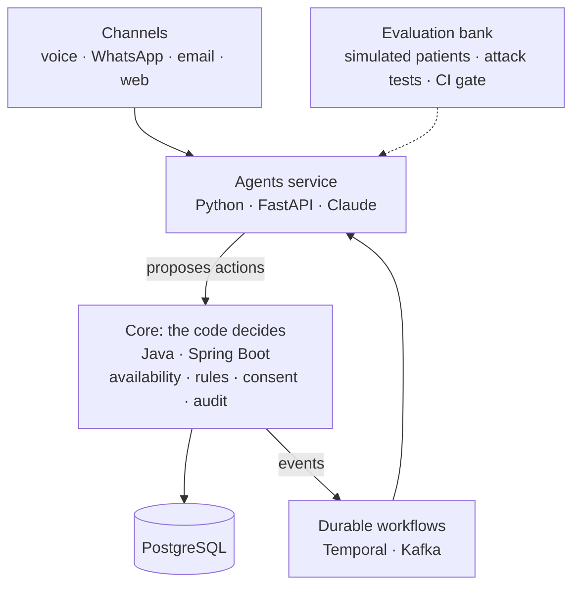

# Turno

[](https://github.com/rnachoc/turno/actions/workflows/ci.yml)
[](LICENSE)

A team of AI agents that answers the phone, WhatsApp and email of a small clinic and takes care of its admin work, with measurable proof that it works.

**The model proposes, the code decides.** No agent can write to the database or move money. Agents propose actions to a transactional core, which enforces rules, permissions and consent. So a malicious email can ask for a refund, but it has no way of getting one.

> **Status: early development.** The core works: patients, availability, bookings with holds, cancellation rules and an append-only audit trail, tested under real concurrency against a real PostgreSQL. **The agents, the channels, consent tracking and payments do not exist yet**, so today Turno is an API with no AI in it, and it only records whether a deposit is forfeited without charging anything; see the [roadmap](#roadmap). Metrics will be published here as they are measured, good or bad.

> **Synthetic data only.** The clinic in this repository is fictional. Never use Turno with real patient data.

## Architecture



This is the target design. Today, `core` and PostgreSQL are functional and `agents` is a tested skeleton. The decisions behind the design are recorded in [`docs/adr`](docs/adr).

## How the core stays correct

| Risk | What stops it | Where |
| --- | --- | --- |
| Two patients in one slot, even under concurrent requests | PostgreSQL exclusion constraints, not application checks | [ADR 6](docs/adr/0006-booking-integrity-in-the-database.md) |
| An agent retries after a timeout and books twice | Idempotency key claimed in the operation's own transaction | [ADR 6](docs/adr/0006-booking-integrity-in-the-database.md) |
| A daylight saving change creates an ambiguous appointment | Slots touching the change are not offered | [`SlotCalculator`](core/src/main/java/io/github/rnachoc/turno/core/availability/SlotCalculator.java) |
| A manipulated agent sets its own price | Requests have no price field, and unknown fields are rejected | [ADR 7](docs/adr/0007-api-authentication-and-boundaries.md) |
| A manipulated agent reaches another patient's appointment | Routes go through the patient, and a mismatch answers `404` | [ADR 7](docs/adr/0007-api-authentication-and-boundaries.md) |
| A manipulated agent charges a no-show | Staff-only operation, checked after routing | [ADR 7](docs/adr/0007-api-authentication-and-boundaries.md) |
| Someone rewrites history | A trigger makes the audit trail append-only | [ADR 6](docs/adr/0006-booking-integrity-in-the-database.md) |

Known limits are listed in those records, such as the service still connecting as the database owner.

## Quick start

You need Docker with Compose.

```bash
cp .env.example .env
docker compose up --build --detach --wait
```

```bash
curl http://127.0.0.1:8080/actuator/health   # core
curl http://127.0.0.1:8000/health            # agents
```

### Book an appointment

This walks through the API with [jq](https://jqlang.org/). On macOS, replace `date -d '+7 days'` with `date -v+7d`.

```bash
set -a; . ./.env; set +a
API=http://127.0.0.1:8080/api/v1
AUTH="Authorization: Bearer $TURNO_API_TOKEN_AGENTS"
post() { curl -s -X POST "$API$1" -H "$AUTH" -H "Idempotency-Key: $(date +%s%N)" -H 'Content-Type: application/json' -d "${2:-{\}}"; }

# Register a synthetic patient
PATIENT=$(post /patients '{"fullName":"Laura Test","phone":"+34600111222","language":"es"}' | jq -r .id)

# Find the first free slot for a check-up in the coming week
SLOT=$(curl -s -H "$AUTH" "$API/availability?treatmentId=check-up&from=$(date +%F)&to=$(date -d '+7 days' +%F)" | jq -c '.[0]')

# Hold it for five minutes, then confirm it
HOLD=$(post "/patients/$PATIENT/appointments" "$(jq -c '{practitionerId, treatmentId, startsAt}' <<< "$SLOT")" | jq -r .id)
post "/patients/$PATIENT/appointments/$HOLD/confirm" | jq '{status, startsAt, priceCents}'
```

## Development

| Module | Requirements | Test command |
| --- | --- | --- |
| `core/` | JDK 25 and Docker (tests run on a real PostgreSQL) | `./mvnw verify` |
| `agents/` | [uv](https://docs.astral.sh/uv/) | `uv run pytest` |

The `Makefile` wraps these commands (`make up`, `make test`, `make lint`) on systems with `make`.

## Repository layout

| Path | Contents |
| --- | --- |
| `core/` | System of record: availability, bookings, rules and audit |
| `agents/` | AI agents and their tools |
| `config/tenants/` | One YAML file per clinic, validated against `config/tenant.schema.json` |
| `docs/adr/` | Architecture decision records |

## Roadmap

- [x] **Phase 0: Foundations.** CI, secret scanning, Docker Compose, ADRs, synthetic clinic.
- [x] **Phase 1: Core.** Availability engine, bookings with holds, cancellation rules, audit. Double-booking and idempotency tests.
- [ ] **Phase 2: Text agent.** Receptionist and scheduler over web chat, with guardrails and rule-based triage.
- [ ] **Phase 3: Evaluations.** Scenario bank, patient simulator, deterministic graders, regression gate over recorded runs ([ADR 8](docs/adr/0008-no-api-budget.md)).
- [ ] **Phase 4: Durable workflow and console.** Slot refill with Temporal, daily owner report, approval queue, traces.
- [ ] **Phase 5: Security.** Attack tests, calibrated LLM judge, model matrix.
- [ ] **Phase 6: Voice.** Streaming pipeline with barge-in and measured latency.
- [ ] **Phase 7: Channels and MCP.** WhatsApp, email, MCP server for the owner.
- [ ] **Phase 8: Release.** Public replay of recorded conversations, video, case study with real numbers.

## Author

Ignacio Rodriguez Caro · [rnachoccontact@gmail.com](mailto:rnachoccontact@gmail.com)

## License

[MIT](LICENSE)
