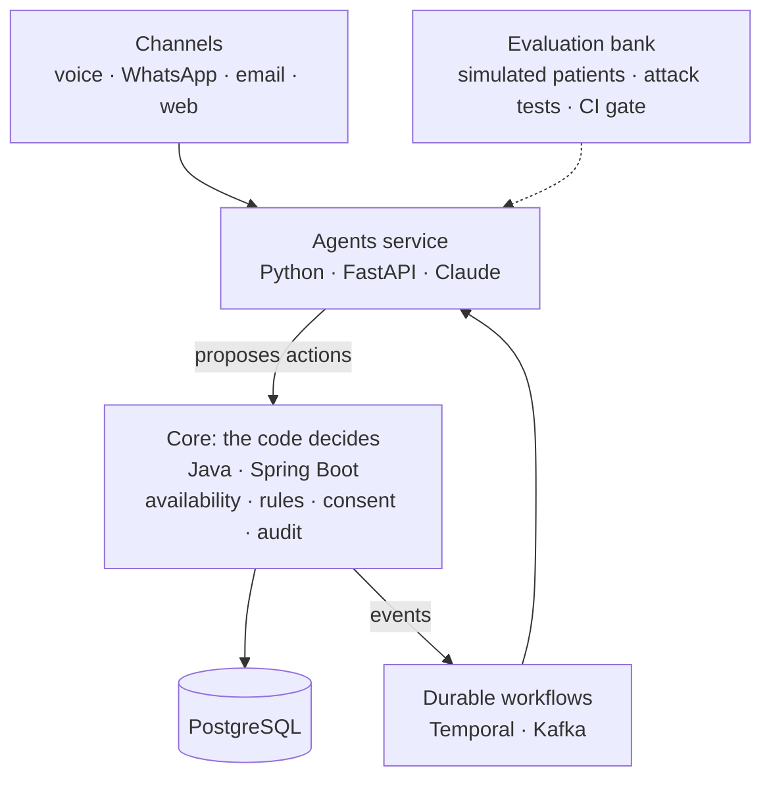

# Turno

[](https://github.com/rnachoc/turno/actions/workflows/ci.yml)
[](LICENSE)

A team of AI agents that answers the phone, WhatsApp and email of a small clinic and takes care of its admin work, with measurable proof that it works.

**The model proposes, the code decides.** No agent can write to the database or move money. Agents propose actions to a transactional core, which enforces rules, permissions and consent. So a malicious email can ask for a refund, but it has no way of getting one.

> **Status: early development.** The foundations (Phase 0) are in place: the services boot, are tested against a real PostgreSQL and run hardened in containers. **Agents, booking and channels do not exist yet**; see the [roadmap](#roadmap). Metrics will be published here as they are measured, good or bad.

> **Synthetic data only.** The clinic in this repository is fictional. Never use Turno with real patient data.

## Architecture



This is the target design. Today, `core`, `agents` and PostgreSQL exist as tested skeletons. The decisions behind the design are recorded in [`docs/adr`](docs/adr).

## Quick start

You need Docker with Compose.

```bash
cp .env.example .env
docker compose up --build --detach --wait
```

```bash
curl http://127.0.0.1:8080/actuator/health   # core
curl http://127.0.0.1:8000/health            # agents
```

## Development

| Module | Requirements | Test command |
| --- | --- | --- |
| `core/` | JDK 25 and Docker (tests run on a real PostgreSQL) | `./mvnw verify` |
| `agents/` | [uv](https://docs.astral.sh/uv/) | `uv run pytest` |

The `Makefile` wraps these commands (`make up`, `make test`, `make lint`) on systems with `make`.

## Repository layout

| Path | Contents |
| --- | --- |
| `core/` | System of record: availability, bookings, rules and audit |
| `agents/` | AI agents and their tools |
| `config/tenants/` | One YAML file per clinic, validated against `config/tenant.schema.json` |
| `docs/adr/` | Architecture decision records |

## Roadmap

- [x] **Phase 0: Foundations.** CI, secret scanning, Docker Compose, ADRs, synthetic clinic.
- [ ] **Phase 1: Core.** Availability engine, bookings with holds, cancellation rules, audit. Double-booking and idempotency tests.
- [ ] **Phase 2: Text agent.** Receptionist and scheduler over web chat, with guardrails and rule-based triage.
- [ ] **Phase 3: Evaluations.** Scenario bank, patient simulator, deterministic graders, regression gate in CI.
- [ ] **Phase 4: Durable workflow and console.** Slot refill with Temporal, daily owner report, approval queue, traces.
- [ ] **Phase 5: Security.** Attack tests, calibrated LLM judge, model matrix.
- [ ] **Phase 6: Voice.** Streaming pipeline with barge-in and measured latency.
- [ ] **Phase 7: Channels and MCP.** WhatsApp, email, MCP server for the owner.
- [ ] **Phase 8: Release.** Public demo with a spending cap, case study with real numbers.

## Author

Ignacio Rodriguez Caro · [rnachoccontact@gmail.com](mailto:rnachoccontact@gmail.com)

## License

[MIT](LICENSE)
