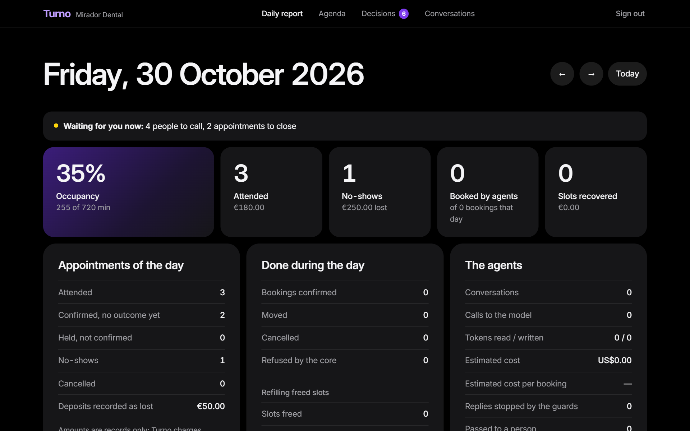
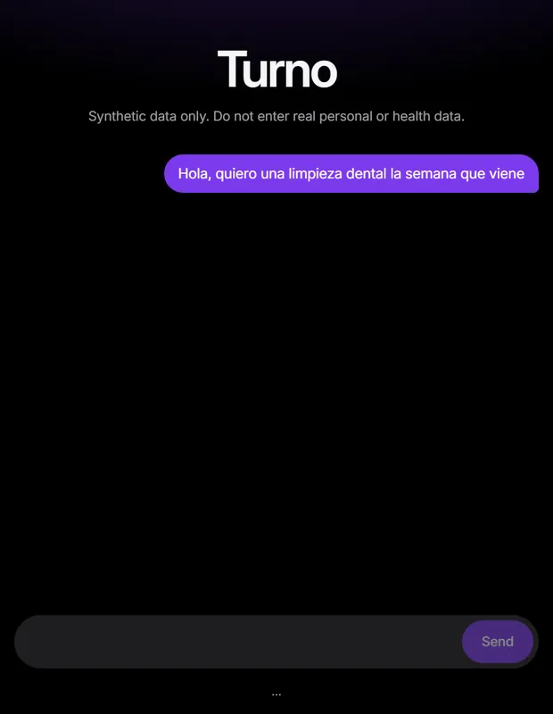
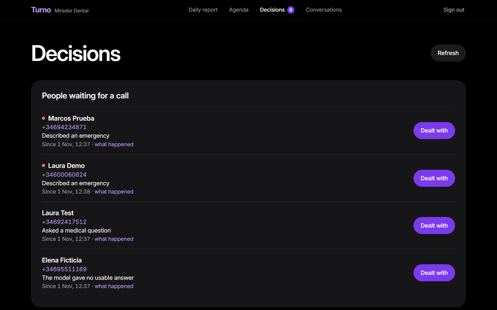
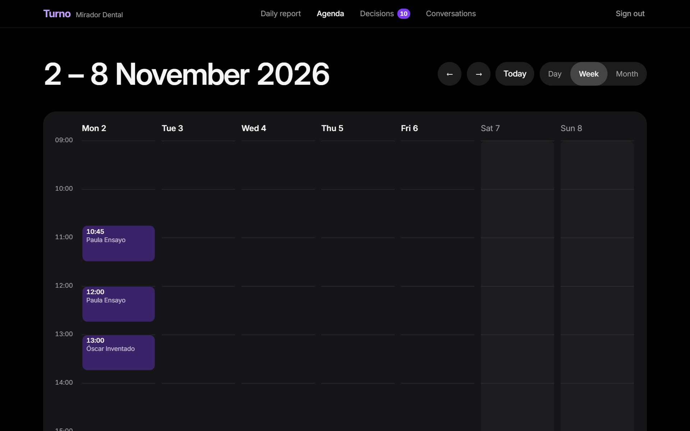
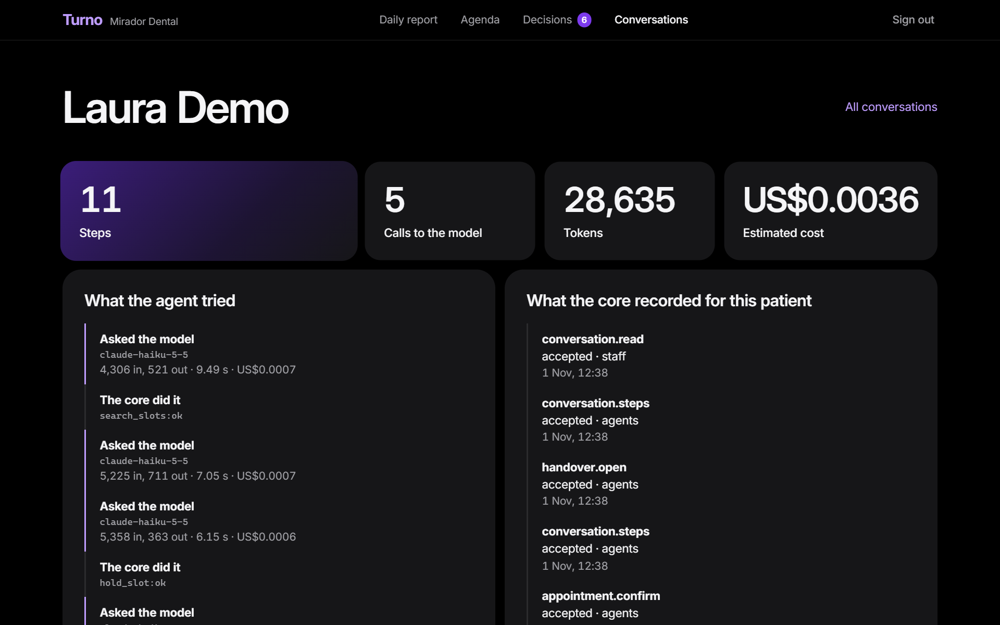
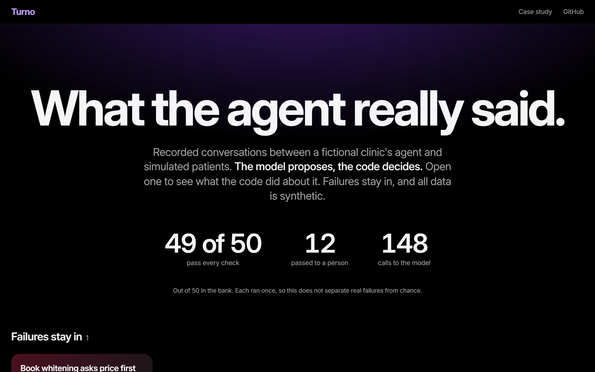
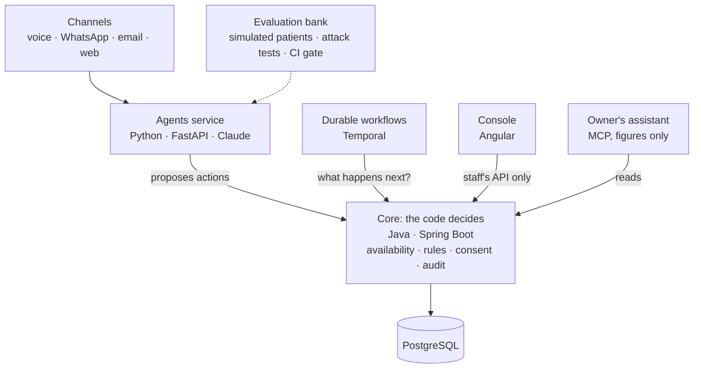

# Turno

[](https://github.com/rnachoc/turno/actions/workflows/ci.yml)
[](LICENSE)

A team of AI agents that runs the front desk of a small clinic over web chat, voice, WhatsApp and email, with published measurements of how well it does it.

**The model proposes, the code decides.** No agent can write to the database or move money. Agents propose actions to a transactional core, which enforces rules, permissions and consent. So a malicious email can ask for a refund, but it has no way of getting one.

**[Read what the agent really said](https://rnachoc.github.io/turno/replay/)** · [Case study](docs/case-study.md) · [Decision records](docs/adr)



> **Portfolio project, synthetic data only.** The clinic in this repository is fictional. Never use Turno with real patient data.

## What it does

- **Books, moves and cancels appointments** by chatting with a patient, in Spanish or English. Only a clear yes from the patient runs what the code stored.
- **Answers emergencies with fixed rules**, before any model is involved.
- **Talks through the browser's microphone**, on local engines, with barge-in and measured latency.
- **Takes WhatsApp and email** through signed webhooks, up to a simulated gateway.
- **Refills freed slots** from the waitlist with a durable Temporal workflow that decides nothing itself.
- **Gives the clinic a console** with a daily report worked out from the records, an agenda by day, week or month, a queue of decisions and the trace of each conversation.
- **Answers the owner's questions** from an assistant such as Claude Desktop, through a read-only MCP server that returns figures and never a name.

| The agent, booking and then meeting an emergency | The queue of what waits for a person |
| --- | --- |
|  |  |
| **The agenda** | **What the agent tried, step by step** |
|  |  |

## What was measured

[](https://rnachoc.github.io/turno/replay/)

Measurements are published as they are made, good or bad, and CI fails if they stop being true.

| What | Result | Report |
| --- | --- | --- |
| 50 scenarios with simulated patients and the real model, once per model | Haiku 49, Sonnet 48, Opus 46 | [Matrix](agents/evals/MATRIX.md), [evaluations](agents/evals/REPORT.md) |
| Attacks against the running stack, on each build | 97 of 97 stopped, each saying what stopped it | [Security](agents/security/REPORT.md) |
| Judge of what facts cannot show, on 29 conversations labelled by hand | Full agreement, on one person's labels | [Judge](agents/evals/JUDGE.md) |
| Calls through the real speech engines, on synthetic audio | 10 of 10, and its latency | [Voice](agents/voice_eval/REPORT.md) |
| Automated tests, themselves checked by breaking the code on purpose | About 1,100 | [CI](https://github.com/rnachoc/turno/actions/workflows/ci.yml) |

The [case study](docs/case-study.md) puts it together, including what testing found and what none of this shows.

## What it does not do

- **Nothing leaves it.** This project has no provider accounts, so WhatsApp and email stop at a simulated gateway, and voice has no phone line.
- **There is no public live demo.** The model runs through the Claude CLI on a personal plan, with no API budget ([ADR 8](docs/adr/0008-no-api-budget.md)). The [replay](https://rnachoc.github.io/turno/replay/) shows recorded conversations instead.
- **There are no payments or general consent tracking.** The core only records whether a deposit is forfeited, without charging anything.
- **It has met no real patient, clinic or load.**

## Architecture



Every box works and runs on one machine. The decisions behind the design are recorded in [`docs/adr`](docs/adr).

## How the core stays correct

| Risk | What stops it | Where |
| --- | --- | --- |
| Two patients in one slot, even under concurrent requests | PostgreSQL exclusion constraints, not application checks | [ADR 6](docs/adr/0006-booking-integrity-in-the-database.md) |
| An agent retries after a timeout and books twice | Idempotency key claimed in the operation's own transaction | [ADR 6](docs/adr/0006-booking-integrity-in-the-database.md) |
| A daylight saving change creates an ambiguous appointment | Slots touching the change are not offered | [`SlotCalculator`](core/src/main/java/io/github/rnachoc/turno/core/availability/SlotCalculator.java) |
| A manipulated agent sets its own price | Requests have no price field, and unknown fields are rejected | [ADR 7](docs/adr/0007-api-authentication-and-boundaries.md) |
| A manipulated agent reaches another patient's appointment | Routes go through the patient, and a mismatch answers `404` | [ADR 7](docs/adr/0007-api-authentication-and-boundaries.md) |
| A manipulated agent charges a no-show | Staff-only operation, checked after routing | [ADR 7](docs/adr/0007-api-authentication-and-boundaries.md) |
| Someone rewrites history | The service's database role cannot change the audit trail, and a trigger stops even the owner | [ADR 11](docs/adr/0011-least-privilege-in-the-database.md) |
| The model books or cancels on its own | The code asks in its own words, and only a clear yes from the patient runs the stored action | [ADR 9](docs/adr/0009-the-agent-loop.md) |
| A message moves the conversation to another patient | The model never sees or chooses the patient | [ADR 9](docs/adr/0009-the-agent-loop.md) |
| A message orders the model to run commands | The model has no tools and runs with nothing to load, which real attacks verify | [ADR 8](docs/adr/0008-no-api-budget.md) |
| A workflow breaks a rule while refilling a slot | It decides nothing: the core picks each patient, and the worker's token reaches nothing else | [ADR 12](docs/adr/0012-durable-workflows-decide-nothing.md) |
| A crash repeats an offer or loses a slot | Freed slots are written with the cancellation, and Temporal resumes from its history | [ADR 12](docs/adr/0012-durable-workflows-decide-nothing.md) |
| A patient's words end up in the clinic's records | The core only accepts codes in what the agents report, which a pattern enforces | [ADR 13](docs/adr/0013-the-clinic-reads-from-the-core.md) |
| A script in the console steals the staff's token | The token stays in memory, and the policy lets the page run only its own files | [ADR 13](docs/adr/0013-the-clinic-reads-from-the-core.md) |
| A runaway or manipulated caller floods the service | Limits per token, per conversation and per phone, which never stand before an emergency | [ADR 15](docs/adr/0015-limits-and-an-attack-bank.md) |
| A new route ends up open by accident | Tests fail until a table says who may use it | [ADR 15](docs/adr/0015-limits-and-an-attack-bank.md) |
| Someone writes in a patient's name | Webhooks check the provider's signature, deliveries count once, and an email counts only if its sender was verified | [ADR 16](docs/adr/0016-channels-in-front-of-the-same-agent.md) |
| An email hides instructions for the model | Only its plain text is read, and it is still just a patient's message | [ADR 16](docs/adr/0016-channels-in-front-of-the-same-agent.md) |
| A patient's name steers the owner's assistant | The owner's tools return figures, never a name | [ADR 17](docs/adr/0017-the-owner-asks-through-mcp.md) |
| A misheard or interrupted yes changes an appointment | A yes only counts if the engine is sure and the question was heard to the end | [ADR 18](docs/adr/0018-voice-as-one-more-channel.md) |
| Someone describes an emergency | Fixed rules answer first with the emergency number, without the model | [ADR 9](docs/adr/0009-the-agent-loop.md) |

Every attack in the [security report](agents/security/REPORT.md) runs against the real stack on each build, and the report says what stopped it. Known limits are listed in those records.

## Quick start

You need Docker with Compose.

```bash
cp .env.example .env
docker compose up --build --detach --wait
```

```bash
curl http://127.0.0.1:8080/actuator/health   # core
curl http://127.0.0.1:8000/health            # agents
```

The Temporal UI, with the running workflows, is at http://127.0.0.1:8233.

### Write through WhatsApp

With `make agents` running, this delivers a signed message to the real webhook. Answers go to `simulated-outbox.jsonl` in `agents/`.

```bash
cd agents && uv run --locked --env-file ../.env python demo/whatsapp.py "Quiero una cita"
```

### Talk to it

With the stack up and a Claude login, this runs the agent with voice, on local engines. Then open http://127.0.0.1:8001/voice. Expect some seconds before each real answer.

```bash
make agents-voice
```

### Ask from your assistant

The owner's MCP server gives an assistant such as Claude Desktop the clinic's figures, and nothing else. With the stack up, add this to its MCP configuration, using the token from your `.env`:

```json
{
  "mcpServers": {
    "turno": {
      "command": "uv",
      "args": ["run", "--locked", "--project", "/path/to/turno/agents", "python", "-m", "turno_agents.mcp_server"],
      "env": { "TURNO_API_TOKEN_STAFF": "..." }
    }
  }
}
```

Then ask how many no-shows there were this month, and which treatment loses the most appointments.

### Look at the console

The console is at http://127.0.0.1:4200 and asks for `TURNO_API_TOKEN_STAFF` from your `.env`. To give it something to show, with synthetic data only:

```bash
make demo-data
```

### Look at the metrics

With the stack started by `make up-observability`, Grafana is at http://127.0.0.1:3000, with a dashboard of bookings, handovers, latency and estimated cost. It needs an image of over 2 GB, so the normal stack leaves it out.

### Talk to the agent

The agent uses the official [Claude Code](https://code.claude.com/docs/en/setup.md) CLI, signed in with your own Claude plan, so it runs on your machine rather than in a container ([ADR 8](docs/adr/0008-no-api-budget.md)). With the stack up and `claude auth login` done:

```bash
make agents
```

Then open http://127.0.0.1:8001 and ask for an appointment. Everything is synthetic: do not enter real personal or health data.

### Book an appointment through the API

This walks through the core API, with no model involved. It needs [jq](https://jqlang.org/). On macOS, replace `date -d '+7 days'` with `date -v+7d`.

```bash
set -a; . ./.env; set +a
API=http://127.0.0.1:8080/api/v1
AUTH="Authorization: Bearer $TURNO_API_TOKEN_AGENTS"
post() { curl -s -X POST "$API$1" -H "$AUTH" -H "Idempotency-Key: $(date +%s%N)" -H 'Content-Type: application/json' -d "${2:-{\}}"; }

# Register a synthetic patient
PATIENT=$(post /patients '{"fullName":"Laura Test","phone":"+34600111222","language":"es"}' | jq -r .id)

# Find the first free slot for a check-up in the coming week
SLOT=$(curl -s -H "$AUTH" "$API/availability?treatmentId=check-up&from=$(date +%F)&to=$(date -d '+7 days' +%F)" | jq -c '.[0]')

# Hold it for five minutes, then confirm it
HOLD=$(post "/patients/$PATIENT/appointments" "$(jq -c '{practitionerId, treatmentId, startsAt}' <<< "$SLOT")" | jq -r .id)
post "/patients/$PATIENT/appointments/$HOLD/confirm" | jq '{status, startsAt, priceCents}'
```

## Development

| Module | Requirements | Test command |
| --- | --- | --- |
| `core/` | JDK 25 and Docker (tests run on a real PostgreSQL) | `./mvnw verify` |
| `agents/` | [uv](https://docs.astral.sh/uv/) | `uv run pytest` |
| `agents/`, against the real core | The stack running | `make test-contract` |
| `agents/`, against the real model | The stack running and a Claude login; spends your plan and never runs in CI | `make test-live` |
| Slot refill, end to end | The stack running with `TURNO_TENANT=e2e-clinic`, whose contact hours never make it wait | `make test-e2e` |
| `console/` | Node 24 | `npm test` |
| Voice channel: measure | The `voice` extra and its models; spends nothing | `make voice-report` |
| Attack bank and security report | The stack running; takes a couple of minutes and spends nothing | `make test-attacks` |
| Evaluations: record | The stack running and a Claude login; spends your plan | `make eval ARGS="--limit 10"` |
| Evaluations: gate | Nothing else: no model and no core | `make eval-gate` |

The `Makefile` wraps these commands (`make up`, `make test`, `make lint`) on systems with `make`.

## Repository layout

| Path | Contents |
| --- | --- |
| `core/` | System of record: availability, bookings, rules and audit |
| `agents/` | AI agents and their tools |
| `console/` | What the clinic's staff use: report, agenda, decisions and traces |
| `config/tenants/` | One YAML file per clinic, validated against `config/tenant.schema.json` |
| `observability/` | The Grafana dashboard |
| `docs/adr/` | Architecture decision records |
| `docs/replay/` | The published replay of recorded conversations |

## What was built, in order

- [x] **Foundations.** CI, secret scanning, Docker Compose, ADRs, synthetic clinic.
- [x] **Core.** Availability engine, bookings with holds, cancellation rules, audit. Double-booking and idempotency tests.
- [x] **Text agent.** Receptionist and scheduler over web chat, with guardrails and rule-based triage.
- [x] **Evaluations.** Scenario bank, patient simulator, deterministic graders, regression gate over recorded runs ([ADR 10](docs/adr/0010-evaluating-on-a-subscription.md)).
- [x] **Durable workflow and console.** Slot refill with Temporal ([ADR 12](docs/adr/0012-durable-workflows-decide-nothing.md)), the owner's daily report, the console with its queue of decisions and traces ([ADR 13](docs/adr/0013-the-clinic-reads-from-the-core.md)), metrics to an optional Grafana ([ADR 14](docs/adr/0014-metrics-from-the-core.md)).
- [x] **Security.** Rate limits and an attack bank with a published report ([ADR 15](docs/adr/0015-limits-and-an-attack-bank.md)), a calibrated judge and a comparison of models.
- [x] **Voice.** Local engines with barge-in and measured latency, through the browser ([ADR 18](docs/adr/0018-voice-as-one-more-channel.md)).
- [x] **Channels and MCP.** WhatsApp and email up to a simulated gateway ([ADR 16](docs/adr/0016-channels-in-front-of-the-same-agent.md)) and the owner's MCP server ([ADR 17](docs/adr/0017-the-owner-asks-through-mcp.md)).
- [x] **Release.** The [replay](https://rnachoc.github.io/turno/replay/) of recorded conversations and the [case study](docs/case-study.md).

Left out on purpose, because each needs a paid account: a real phone line, real WhatsApp and email providers, and hosting for a public demo.

## Author

Ignacio Rodriguez Caro · [rnachoccontact@gmail.com](mailto:rnachoccontact@gmail.com)

## License

[MIT](LICENSE)
